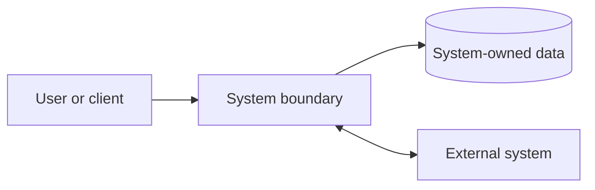

# [Initiative] architecture design

**Status:** [What is approved, proposed, and pending] · **Updated:** YYYY-MM-DD

This design covers [scope]. [Links to PRD, decisions, domain/UX, and constraints.]

## Stack and boundary overview

| Layer | Choice | Status and reference |
| --- | --- | --- |
| [Client/interface] | [Responsibility and choice/option] | [Approved/proposed/pending; link] |
| [Application/service] | [ ] | [ ] |
| [Data/integration/operations] | [ ] | [ ] |

## Authentication, authorization, and trust boundaries

- [Identity, authority, session, secret, and audit boundary.]

## Persistence, isolation, and files

- [Data ownership/isolation, lifecycle, backup/recovery, and migration assumptions.]

## Integrations and functional boundaries

| Boundary or integration | Responsibility and flow | Failure/retry/ownership | Status / validation |
| --- | --- | --- | --- |
| [ ] | [ ] | [ ] | [ ] |

## Deployment and operations

| Concern | Design / constraint | Status or evidence |
| --- | --- | --- |
| Environments and configuration | [ ] | [ ] |
| Observability and support | [ ] | [ ] |
| Migration, backup, and rollback | [ ] | [ ] |

## Validation and handoff

1. [Review, spike, or operational preparation; decision criteria and owner.]

## Remaining review

1. [Open risk, conditional choice, or dependency.]
